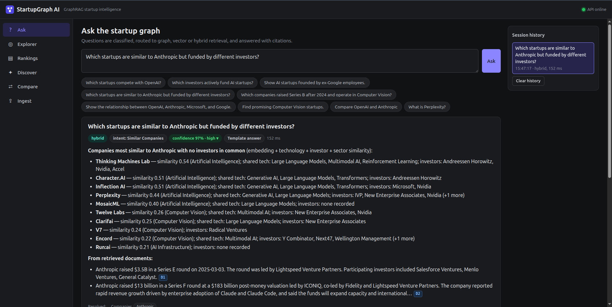
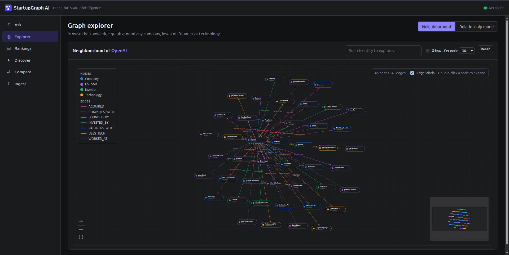
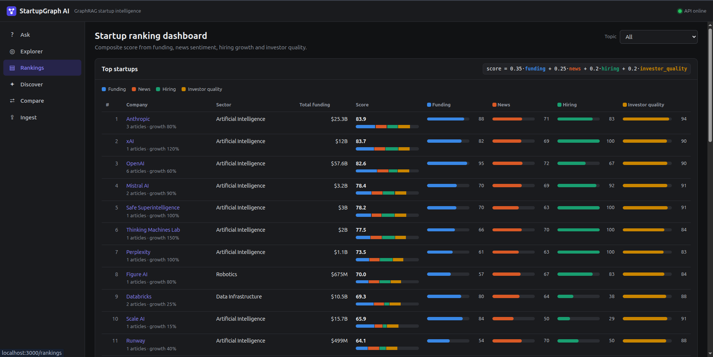
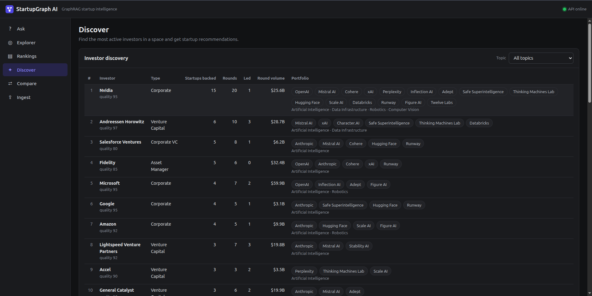
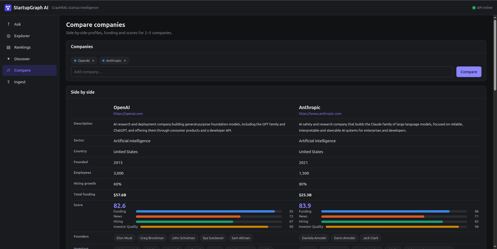
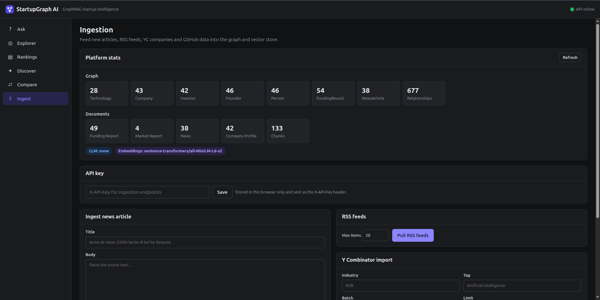
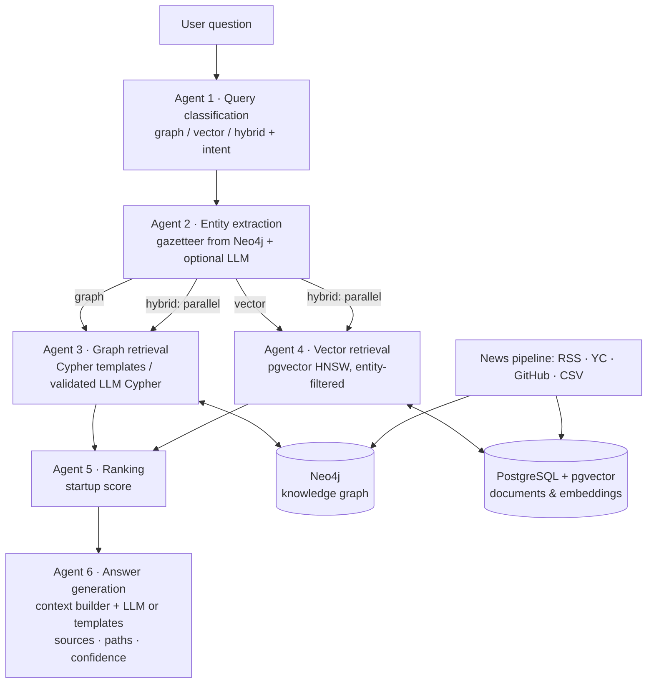

# StartupGraph AI

**GraphRAG startup intelligence platform**: ask questions about startups, founders, investors, technologies, funding rounds and acquisitions, and get explainable answers that combine **knowledge-graph traversal (Neo4j)**, **vector search (PostgreSQL + pgvector)** and **LLM reasoning**, orchestrated by a **LangGraph** multi-agent workflow.

Vector search alone is good at "what is X?". It struggles with multi-hop questions such as *"Who funds OpenAI's competitors?"* (company → competitors → investors) or *"AI startups founded by ex-Google employees"* (startup → founder → former employer, including Google subsidiaries). StartupGraph routes each question to graph retrieval, vector retrieval or both. It then ranks the companies it finds and answers with sources, relationship paths and a confidence score.

```
Q: Who funds OpenAI competitors?
→ intent: competitor_investors · retrieval: graph · confidence 0.97 (high)

Investors backing competitors of OpenAI [G]:
- Nvidia (Corporate) funds 9 competitor(s): Inflection AI, Adept, Mistral AI, Cohere, xAI, Perplexity (+3 more)
- Andreessen Horowitz (Venture Capital) funds 5 competitor(s): Mistral AI, Character.AI, xAI, Safe Superintelligence, …
Example relationship paths:
- OpenAI -[COMPETES_WITH]- Mistral AI -[INVESTED_BY]-> Nvidia
```

## Screenshots

The web app has six pages, listed in the left sidebar. The green dot in the top-right corner shows whether the backend API is online.

### 1. Ask: questions in plain English



Type a question, or click one of the example chips, and the multi-agent workflow answers it.

- **Badges** under the question show how it was handled:
  - **retrieval mode** (`graph`, `vector` or `hybrid`) and the **intent** detected, such as *Similar Companies*
  - the **confidence score**; click it to see what it's made of
  - whether the answer was written by an **LLM** or a **template**
  - the response time
- **The answer** is explainable. In this example, each similar company has a similarity score, the technologies it shares with Anthropic, and its investors. Every company shown has *no* investors in common with Anthropic, as the question asked.
- **Citations** such as `D1` and `D2` link to source documents, and `G` means the fact came from the knowledge graph. Clicking a citation jumps to that source.
- **Tabs below the answer** show the supporting evidence:
  - **Graph:** an interactive picture of the nodes used
  - **Paths:** relationship chains such as `OpenAI -[COMPETES_WITH]- Mistral AI -[INVESTED_BY]-> Nvidia`
  - **Sources:** the documents and graph facts behind the answer
  - **Rankings:** startup scores
  - **Agent trace:** what each of the six agents did and how long it took
  - **Cypher:** the exact database queries that ran
- **Session history** on the right keeps your previous questions, so you can reopen them.

### 2. Explorer: browse the knowledge graph



A visual map of how entities are connected, shown here for OpenAI's neighbourhood.

- **Node colours** show the entity type: blue for companies, purple for founders, green for investors and yellow for technologies.
- **Line styles** show the relationship. For example, red dashed lines are `COMPETES_WITH`, green lines are `INVESTED_BY`, purple lines are `FOUNDED_BY`, and dotted lines are `WORKED_AT`.
- Use **Search entity** to centre the map on any company, investor, founder or technology.
- **Click a node** to see its details. **Double-click** it to expand its own connections.
- **2-hop** also loads the neighbours' neighbours. **Per node** limits how many connections of each type are shown.
- **Relationship mode** (top right) lets you pick 2–5 entities and see every path that connects them.
- Zoom controls and a minimap are at the bottom. "Edge labels" can be turned off when the map is crowded.

### 3. Rankings: startup ranking dashboard



A leaderboard of startups ranked by the **Startup Score**:

```
score = 0.35 × funding + 0.25 × news + 0.20 × hiring + 0.20 × investor quality
```

- **Total funding** is the sum of all known funding rounds.
- **Score** is out of 100. The coloured bar under it shows how much each signal contributes.
- **The four component columns**, each scored 0–100:
  - **Funding:** how much money the company has raised (log scale)
  - **News:** how positive recent news coverage is; the article count is shown under the company name
  - **Hiring:** headcount growth, also shown under the name, e.g. "growth 80%"
  - **Investor quality:** the reputation of the company's top investors
- The **Topic** dropdown filters to a sector, such as Computer Vision or Robotics.
- Click a company to open a detail panel with its profile, score and latest news. Further down the page are funding-trend and sector charts.

### 4. Discover: investor discovery and recommendations



**Investor discovery** answers "who is most active in this space?":

- **Startups backed:** the number of distinct startups the investor has funded.
- **Rounds:** the number of funding rounds it took part in. **Led** is how many of those it led.
- **Round volume:** the total size of the rounds it joined.
- **Portfolio:** the companies it backed, with the sectors they belong to underneath.
- **Quality:** the investor rating used in the startup score.

Choose a **Topic** to see, for example, the most active Computer Vision investors. Further down the page, **Recommendations** list the most promising startups in a topic, each with its score, funding, investors and three similar companies.

### 5. Compare: side-by-side company comparison



Add 2–5 companies and click **Compare**. The page shows each company in its own column:

- description, sector, country, founding year, employees and hiring growth
- total funding and the **startup score**, with its four component bars
- founders, investors, technologies, competitors, partners and every funding round

An **In common** section highlights shared investors, technologies, competitors and partners. A **Similar companies** panel finds look-alikes for any company. It has a "different investors only" option, for questions like "who resembles Anthropic but is funded by other people?".

### 6. Ingest: add new data



Keeps the knowledge base up to date.

- **Platform stats** show what's stored. **Graph** counts each node type and the total number of relationships. **Documents** shows the stored text and the number of embedded chunks used for semantic search. The badges show the active LLM provider and embedding model.
- **API key:** ingestion endpoints are protected in production. Enter the `ADMIN_API_KEY` here; it is kept only in your browser.
- **Ingest news article:** paste a headline and body. The pipeline detects events such as funding rounds, acquisitions, partnerships and product launches, and updates the graph. For example, "Acme AI raises $50M Series B led by Sequoia" creates the company, the funding round and the investor links.
- **RSS feeds:** pulls the latest TechCrunch startup, AI and venture news through the same pipeline.
- **Y Combinator import:** loads companies from the public YC directory, filtered by industry, tag or batch.
- **GitHub enrichment** (further down) adds repository, star and follower counts for companies' GitHub organisations.

## Architecture



| Layer | Tech |
|---|---|
| API | FastAPI (async), Pydantic v2 |
| Agents | LangGraph `StateGraph` (parallel branches for hybrid retrieval), LangChain chat models |
| Graph | Neo4j 5 (async driver, READ transactions for all retrieval) |
| Vectors | PostgreSQL 16 + pgvector (HNSW, cosine) |
| Embeddings | Sentence Transformers (`all-MiniLM-L6-v2`, default), OpenAI or Gemini embeddings |
| LLM (optional) | OpenAI, Gemini or Anthropic Claude, selected with `LLM_PROVIDER` |
| Frontend | React + TypeScript + Vite, React Flow (graph visualisation), Recharts |
| Infra | Docker Compose, GitHub Actions CI, EC2 deploy over SSH |

### Runs with or without an LLM

With `LLM_PROVIDER=none` (the default), every agent has a deterministic implementation: rule-based classification, gazetteer entity extraction, reviewed Cypher templates and templated answers. The platform works fully offline and the tests are reproducible. Set `LLM_PROVIDER=openai|gemini|anthropic` and the agents use the LLM for classification, extraction, Cypher generation for questions no template covers, event extraction and answer synthesis. Each LLM call falls back to the rules if it fails.

**Guardrails**
- Entities proposed by the LLM must resolve to real graph nodes, so hallucinated names never reach Cypher.
- LLM-generated Cypher must pass a validator: a single read-only statement, no write or admin clauses, no procedures except an allow-list, and an enforced `LIMIT`. It then runs inside a Neo4j **READ** transaction with a timeout.

## Knowledge graph

Every node also carries the label `:Entity` with a unique `id`, so one node can play several roles. Microsoft, for example, is both a `:Company` and an `:Investor`.

| Node | Key properties |
|---|---|
| `Company` | id, name, description, sector, tags, country, founded_year, employee_count, employee_growth_pct, website, total_funding |
| `Founder:Person` | id, name, linkedin_url, background, previous_companies |
| `Investor` | id, name, type, fund_size, quality |
| `Technology` | name, category |
| `FundingRound` | round_type, amount, date |
| `NewsArticle` | title, url, published_at, event_type |

Relationships: `FOUNDED_BY`, `INVESTED_BY` (company→investor aggregate and round→investor with `lead`), `RAISED`, `USES_TECH`, `COMPETES_WITH`, `PARTNERS_WITH`, `ACQUIRED`, `WORKED_AT`, `MENTIONED_IN`.

PostgreSQL stores company profiles, news articles, funding reports and market reports as chunked documents with embeddings, plus one embedding per company for similarity search.

## Questions it answers

| Question | Intent | Retrieval |
|---|---|---|
| Which startups compete with OpenAI? | competitors | graph |
| Which investors actively fund AI startups? | active_investors | graph |
| Show AI startups founded by ex-Google employees. | founder_background (includes Google DeepMind via `ACQUIRED`) | graph |
| Which startups are similar to Anthropic but funded by different investors? | similar_companies | hybrid |
| Which companies raised Series B after 2024 and operate in Computer Vision? | funding_search | graph |
| Show the relationship between OpenAI, Anthropic, Microsoft, and Google. | relationship (direct edges + shortest paths) | graph |
| What is OpenAI? | general | vector |
| Compare OpenAI and Anthropic | compare | hybrid |
| Find promising Computer Vision startups. | recommendation | hybrid |

Plus: investors of a company, investor portfolios, founders, acquisitions and technology users. Questions about unknown entities fall back to document search, and the answer says so.

"After 2024" is read strictly (2025 onward). If no rounds match, the agent relaxes the filter to include 2024 and adds a note saying it did.

## Startup score

```
Startup Score = 0.35 × Funding + 0.25 × News sentiment + 0.20 × Hiring growth + 0.20 × Investor quality
```

Each component is normalised on an absolute scale, so scores are comparable across queries:

- **Funding:** log-scaled total raised, from $1M (0) to $100B (1).
- **News:** mean sentiment of the company's news, shrunk toward neutral when coverage is thin.
- **Hiring:** headcount growth, from −20% (0) to +100% (1).
- **Investor quality:** mean of the top three investor quality ratings, plus a small bonus for investor breadth.

**Company similarity** combines four signals: description embeddings (40%), Jaccard overlap of technologies (25%), investors (20%) and sector/tags (15%). With "different investors", any candidate sharing an investor is excluded and the investor weight is dropped.

## Quick start

Requires Docker with Compose v2.24+.

```bash
cp .env.example .env            # optional: add an LLM key and set LLM_PROVIDER
docker compose up -d --build    # neo4j, postgres, backend (auto-seeds), frontend
```

- App: http://localhost:3000
- API docs: http://localhost:8000/docs
- Neo4j browser: http://localhost:7474 (neo4j / startupgraph)

### Local development

```bash
docker compose up -d neo4j postgres
python3 -m venv .venv && .venv/bin/pip install -r backend/requirements-dev.txt
.venv/bin/pip install --index-url https://download.pytorch.org/whl/cpu torch && .venv/bin/pip install -r backend/requirements-ml.txt
cd backend
../.venv/bin/uvicorn app.main:app --reload            # seeds the graph on first start
../.venv/bin/python -m scripts.ask                    # run the demo questions in the terminal
../.venv/bin/python -m scripts.ask "Who invested in Mistral AI?" --json

cd ../frontend && npm install && npm run dev          # http://localhost:5173 (proxies /api to :8000)
```

## API

| Method | Path | Purpose |
|---|---|---|
| POST | `/api/query` | Ask a question. Returns the answer, intent, entities, confidence, sources, relationship paths, executed Cypher, graph (nodes/edges), documents, rankings, similar companies and the agent trace |
| GET | `/api/entities/search?q=` | Entity autocomplete |
| GET | `/api/graph/neighborhood?id=&expand=` | Relationship explorer |
| GET | `/api/graph/relationship?ids=a,b,c` | How entities connect |
| GET | `/api/companies`, `/api/companies/{id}`, `/api/companies/{id}/similar` | Company profiles, scores, news, similarity |
| GET | `/api/rankings?topic=` | Startup ranking dashboard |
| GET | `/api/recommendations?topic=` | Promising startups with similar companies |
| GET | `/api/investors/discover?topic=` | Investor discovery |
| GET | `/api/compare?ids=a,b` | Company comparison |
| GET | `/api/analytics/trends`, `/api/analytics/sectors` | Funding trends and sector breakdown |
| POST | `/api/ingest/article`, `/rss`, `/yc`, `/github`, `/csv`, `/seed` | Ingestion. Requires `X-API-Key` when `ADMIN_API_KEY` is set (it must be set in production) |
| GET | `/health`, `/ready` | Liveness / readiness (checks both databases) |

## Data sources and the news intelligence pipeline

| Source | How |
|---|---|
| Curated seed | 42 companies, 42 investors, 46 founders, 54 funding rounds, partnerships, acquisitions and 35 news articles and market reports (`backend/data/seed`). Loaded automatically on first start. |
| RSS / funding news | `POST /api/ingest/rss`, or set `RSS_POLL_MINUTES` for background polling. Defaults to the TechCrunch startups, AI and venture feeds. |
| Y Combinator directory | `POST /api/ingest/yc` (public [yc-oss](https://github.com/yc-oss/api) dataset, filterable by industry, tag and batch) |
| GitHub organisations | `POST /api/ingest/github` enriches companies with repo, star and follower counts (set `GITHUB_TOKEN` for higher rate limits) |
| Crunchbase and other exports | `POST /api/ingest/csv` with a CSV you are licensed to use (Crunchbase-style column names are recognised) |

Each article passes through these steps:

1. **Event detection:** funding (amount, round, lead and participating investors), acquisitions, partnerships and product launches.
2. **Graph update:** idempotent `MERGE`s, e.g. *"A acquires B"* → `(A)-[:ACQUIRED]->(B)`. New companies get sector tags inferred from the text.
3. **Linking:** `NewsArticle` + `MENTIONED_IN` links to every known entity.
4. **Storage:** sentiment scoring, chunking and embedding into pgvector.

Event detection uses regex patterns by default and the LLM when one is configured. The LLM is noticeably better on headlines without a standard "X raises $Y" shape.

**Please note:**
- Crunchbase and LinkedIn are **not scraped**. Their terms prohibit it, and Crunchbase's API is a paid licence. Use the CSV importer with licensed exports instead.
- The seed dataset is a demo sample compiled from public reporting. Amounts, dates and relationships are approximate and may be out of date. `employee_growth_pct` and investor `quality` are illustrative inputs to the scoring model, not measured data. Verify anything before relying on it.

## Embedding models

`EMBEDDING_DIM` must match the model, because the pgvector columns are created with that size. The backend records which model produced the stored vectors and refuses to start on a mismatch, so vectors from different models are never mixed. After switching models, run:

```bash
python -m app.ingestion.reindex
```

## Testing

```bash
cd backend
pytest -m "not integration"   # 54 unit tests: classifier, entities, Cypher safety, scoring, events, answers, LLM stubs
pytest -m integration         # 14 end-to-end API tests against real Neo4j + Postgres (seeds automatically)
ruff check .
```

CI (`.github/workflows/ci.yml`) runs lint and unit tests, then integration tests against Neo4j and pgvector service containers, then the frontend type-check and build, then the Docker image builds. An optional EC2 deploy runs on `main`.

## Deploying to AWS EC2

1. Launch Ubuntu 22.04/24.04 on t3.large or larger (Neo4j, Postgres and the embedding model need about 4 GB RAM). Open port 80 in the security group, or put it behind an ALB or Caddy for TLS.
2. On the instance, run:
   ```bash
   curl -fsSL https://raw.githubusercontent.com/<owner>/<repo>/main/infra/ec2-bootstrap.sh | sudo bash -s -- https://github.com/<owner>/<repo>.git
   ```
   This installs Docker, clones the repo to `/opt/startupgraph`, generates random DB passwords and an admin API key in `.env`, and starts the production stack. For a private repo, clone it yourself first and run `sudo bash infra/ec2-bootstrap.sh <repo-url>` from the clone.
3. For continuous deployment, set repository variable `DEPLOY_ENABLED=true` and secrets `EC2_HOST`, `EC2_USER`, `EC2_SSH_KEY`. Pushes to `main` then redeploy after CI passes.

`docker-compose.prod.yml` keeps Neo4j, Postgres and the API private to the Docker network. Only nginx is published, and it serves the SPA and proxies `/api`.

## Project structure

```
backend/
  app/
    agents/       classifier, entities, cypher (templates + validator), llm_agents, answer, workflow (LangGraph)
    api/          FastAPI routes (query, explore, insights, ingest), schemas
    db/           neo4j_store (async, READ tx, graph serialisation), vector_store (pgvector)
    ingestion/    seed loader, news event extraction, RSS/YC/GitHub/CSV pipeline, reindex
    services/     graph writer, scoring, sentiment, ranking/similarity/analytics
    llm/          chat-model and embedding providers
  data/seed/      curated dataset
  scripts/        ask.py (CLI), delete_entity.py
  tests/          unit + integration
frontend/         React + TypeScript + React Flow UI
infra/            EC2 bootstrap
docs/screenshots/ UI screenshots used in this README
docker-compose.yml, docker-compose.prod.yml, .github/workflows/ci.yml
```

## Limitations and next steps

- **Funding prediction model:** not implemented yet. The scoring signals and funding history are in place to train one.
- **Hiring signals:** come from seed data or the YC team size. A jobs-API or LinkedIn-licensed feed would make them live.
- **Sentiment:** scored with a finance-news lexicon. An LLM or FinBERT scorer would be more accurate.
- **Scaling:** each backend container runs one worker, because startup seeding and the RSS poller run in-process. Scale by adding replicas and move polling to a scheduled job.
